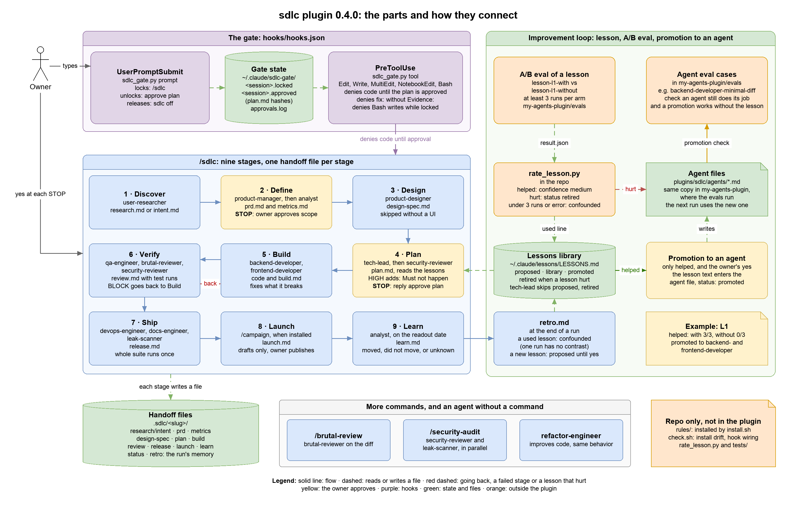

# sdlc

A risk-tiered software development process for [Claude Code](https://code.claude.com): role agents that plan, build, verify and ship, gates where a person decides, and evidence instead of claims.

It uses the lightest process the risk allows. A one-line UI fix goes straight through; an auth change waits for a design review and your yes. A skipped gate is reported as skipped, and a check that did not run is reported as not run.



The diagram's source is `docs/architecture.drawio`. Open it in [draw.io](https://app.diagrams.net) and export it again to `docs/architecture.png` after a change.

## Install

**Plugin** (agents, commands and gate hooks):

```
/plugin marketplace add amir1824/sdlc
/plugin install sdlc@sdlc
```

**Rules** (recommended, since the agents assume them):

```bash
git clone https://github.com/amir1824/sdlc.git && cd sdlc && scripts/install.sh
```

`install.sh` copies the rules into `~/.claude/rules/`. A file it replaces is moved to `~/.claude/.sdlc-backup/<time>/` first; nothing is deleted.

<details>
<summary>Maintaining this repo: link instead of copy</summary>

`scripts/install.sh --link --agents` links the rules, agents and commands into `~/.claude`, so `git pull` updates your install. Do not combine it with the plugin install, or each agent appears twice. Skills ship with the plugin install only: `--link --agents` does not link them, so the `sdlc:<name>` skills the agents name are skipped there. Plugin hooks load only with the plugin, so wire them in `~/.claude/settings.json` yourself (back it up first; `scripts/check.sh` shows `linked` once they are there):

```json
"hooks": {
  "UserPromptSubmit": [
    { "hooks": [{ "type": "command", "command": "python3 -I /path/to/sdlc/plugins/sdlc/hooks/sdlc_gate.py prompt", "timeout": 5 }] }
  ],
  "PreToolUse": [
    { "matcher": "Edit|Write|MultiEdit|NotebookEdit|Bash",
      "hooks": [{ "type": "command", "command": "python3 -I /path/to/sdlc/plugins/sdlc/hooks/sdlc_gate.py tool", "timeout": 5 }] }
  ]
}
```

To keep your own version of a file (for example an agent with your own MCP tools), list it in `~/.claude/.sdlc-local-overrides`, one path per line (`agents/product-manager.md`). `install.sh` never replaces a listed file.

</details>

## When to use `/sdlc`

`/sdlc` is for a feature that starts from an idea and spans several files. `/sdlc lean <change>` is the short path for a change to existing code whose behavior is stated: a plan you approve, the build, an independent review and the whole suite, without PRD, metrics, launch or learn (and, for LOW and MEDIUM, without the Ship stage). The first reply says which path it recommends, and you can switch with `lean` or `full`. A small change follows `rules/sdlc.md` without it: LOW is done and checked, MEDIUM gets a short plan and an independent review, and HIGH gets a design review and your yes before the first edit. In `claude -p` call `/sdlc:sdlc` (a bare `/sdlc` may not load the command there while the gate still locks edits). In `claude -p` each STOP ends the call, so answer each gate in its own call that resumes the same session (`--resume`), with `approve plan` alone and after any question the chair asked in words, and allow the commands the stages run (`git`, `shasum`, `xargs`, `cp`, `mktemp`, `python`, the project's test runner), or Verify and Ship stop.

## What is inside

| Path | What |
|---|---|
| `plugins/sdlc/agents/` | 14 role agents: planning, building, review, security, devops, docs and research |
| `plugins/sdlc/commands/` | `/sdlc` (the full pipeline), `/brutal-review`, `/security-audit` |
| `plugins/sdlc/hooks/` | the gate hooks (`sdlc_gate.py`, wired by `hooks.json`) |
| `plugins/sdlc/skills/` | the six skills the gates call |
| `rules/` | 7 engineering rules for `~/.claude/rules/` |
| `scripts/` | `install.sh`, `check.sh` (drift, hook wiring, versions), and the tools for the [lessons library](docs/lessons-library.md) |
| `extras/` | optional skills that are not part of the plugin, each with its own eval suite (`restructure-codebase`) |
| `tests/` | unit tests for the hooks and the scripts |
| `docs/` | the diagram, the lessons library guide and the list of optional skills |

## How it works

**1. Classify the risk first** (`rules/sdlc.md`).

| Risk | Examples | Process |
|---|---|---|
| LOW | small UI change, local refactor, docs, isolated bug fix | Do it, then run the one check that proves it. |
| MEDIUM | new feature, shared component, API behaviour change | A short plan with acceptance criteria, then build, test, and an independent review. |
| HIGH | auth, migrations, concurrency, infrastructure, anything security-sensitive | Design review with failure analysis and rollback. You say yes before the first edit. |

**2. `/sdlc` runs a feature through nine stages.** Each stage writes a handoff file in `.sdlc/<slug>/`; the files, not the chat, are the project's memory.

| # | Stage | Agent | Writes |
|---|---|---|---|
| 1 | Discover | `user-researcher`, or the chair when you state the problem | `research.md` / `intent.md` |
| 2 | Define (**STOP**: you approve scope) | `product-manager`, `analyst` | `prd.md`, `metrics.md` |
| 3 | Design (skipped without UI) | `product-designer` | `design-spec.md` |
| 4 | Plan (**STOP**: you approve the plan) | `tech-lead`, then `security-reviewer` | `plan.md` |
| 5 | Build | `backend-developer`, `frontend-developer` | code, `build.md` |
| 6 | Verify | `qa-engineer`, `brutal-reviewer`, `security-reviewer` | `review.md` |
| 7 | Ship | `devops-engineer`, `docs-engineer`, `leak-scanner` | `release.md` |
| 8 | Launch (optional, needs `/campaign`) | marketing | `launch.md` |
| 9 | Learn (on the readout date) | `analyst` | `learn.md` |

- The plan maps every requirement to its files and its proving check, lists every call site a change must cover, and names the trust boundaries before any code exists. For HIGH work it also lists what **must not happen** and the assumptions made about the request, so you can catch a missing requirement before code exists.
- When a plan adds a schema or migration, changes an event name or payload or a public API signature, or adds a dependency, a service, a trust boundary or a module (or is new-product work, or HIGH work that crosses components), it carries an As-Is and a To-Be diagram (Mermaid, inside `plan.md`) and a table of the components and contracts it touches, each with a check that can run. Your `approve plan` covers the diagrams, because the plan hash does; the hash binds the file, not your reading of it, so read the rendered diagram, or the source, before you approve. A routine change gets one line saying why there is no diagram. A diagram shows the proposed design, not that it is right, and this is a prompt the model follows, not a check.
- A builder fixes what its change breaks and lists each such file in `build.md`.
- For HIGH work every test run is recorded in `review.md` with a fingerprint of the code it ran on. At Ship, a run whose code changed since is stale and runs again.
- A run survives a closed session: `/sdlc resume <slug>` continues from `status.md`. You type `approve plan` again, because the gate never counts an earlier approval.

**3. Gate hooks** (`plugins/sdlc/hooks/`). A rule written in a prompt holds only while the model reads it the way you meant, so the gates that must hold are hooks.

- **No code before the plan is approved.** `/sdlc` locks code edits (Edit, Write, MultiEdit, NotebookEdit) and Bash writes in that session. Files under `.sdlc/` stay writable with the Write tool. Reply `approve plan` to unlock; your words are logged in `~/.claude/sdlc-gate/approvals.log`, and the approval is bound to the hash of each `.sdlc/*/plan.md`, so a changed or new plan locks again. Any other reply, however positive, leaves the lock in place. A plan can hold an `sdlc-scope` block, which the approval freezes: only matching files can then be edited. With several plans and one scope block, reply `approve plan <folder>`. `sdlc off` releases the session.
- **`fix:` commits need evidence.** A `fix:` commit whose message has no `Evidence:` line is denied.
- **Read-only agents stay read-only.** A Bash command from `tech-lead`, `security-reviewer`, `brutal-reviewer`, `analyst` or `leak-scanner` is denied when it matches a list of common writes: redirects, `rm`/`mv`/`cp`, inline interpreter code, git commands that change state, installs.
- **The gate's own state is the owner's.** A Bash command that writes to `~/.claude/sdlc-gate/` is denied in every session.

These gates are a best-effort guardrail. They stop a misread reply and a model's slip, not an agent set on getting past them: Bash writes are judged by a denylist, so a verb it does not list gets through, and a scope pattern is not checked for Bash. They do not show that your requirements are right, only that the workflow was followed. An action that must never happen belongs in Claude Code's permission deny rules or a sandbox.

If the gate itself crashes in a locked or approved session, it denies the action (reply `sdlc off` to release). In any other session an error lets the action through. While locked, some read pipelines such as `npm test | tee out.log` are denied too; `approve plan` or `sdlc off` ends that. The gates need `python3` 3.9 or later. `SDLC_GATE=off` turns them off, `SDLC_GATE_SCOPE=off` turns off only the scope check, and `SDLC_GATE_TRACE=1` logs what Claude Code sends each hook to `~/.claude/sdlc-gate/trace.log`.

## Skills

Six skills that the gates call ship inside the plugin, so they work right after install: `architecture-slayer`, `idea-slayer`, `change-impact`, `canary-watch`, `browser-qa` and `click-path-audit`. The agents load them as `sdlc:<name>`; four came from the [ECC plugin](https://github.com/affaan-m/ECC), and `plugins/sdlc/skills/THIRD_PARTY_NOTICES.md` has the credits and license. If you also have ECC installed, its copies are the same skills under `ecc:<name>`.

The agents also list optional skills to load when they fit, mostly from ECC. They are not bundled; [docs/skills.md](docs/skills.md) lists each one and who uses it. A skill that is not installed is skipped, and a gate that cannot run says "not run" at the top of its file instead of inventing a verdict.

## The lessons library (optional)

`/sdlc` can learn between runs: lessons from each retro are rated by an A/B eval and, when they help and you agree, promoted into an agent. See [docs/lessons-library.md](docs/lessons-library.md).

## Versions and changing it

- `plugins/sdlc/.claude-plugin/plugin.json` and `.claude-plugin/marketplace.json` carry the same [semver](https://semver.org) version; `scripts/check.sh` fails when they differ.
- To update, plugin users run `/plugin marketplace update sdlc`. With `--link`, `git pull` is enough. With a copy, run `scripts/install.sh` again.
- `scripts/check.sh` lists every installed file as linked, same, DRIFT, local or missing, so you can see a local edit that never reached the repo.

To change the plugin: edit the agent, command or rule in this repo, run `scripts/check.sh` and `python3 -I -m unittest discover -s tests`, bump the version in both JSON files, add a `CHANGELOG.md` entry, and open a pull request. A change to how an agent behaves is worth an eval run before it ships.
